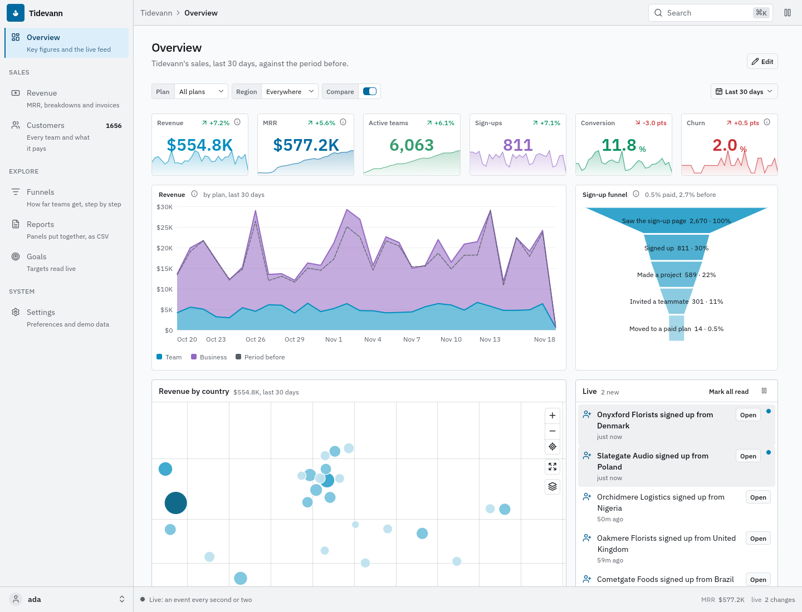
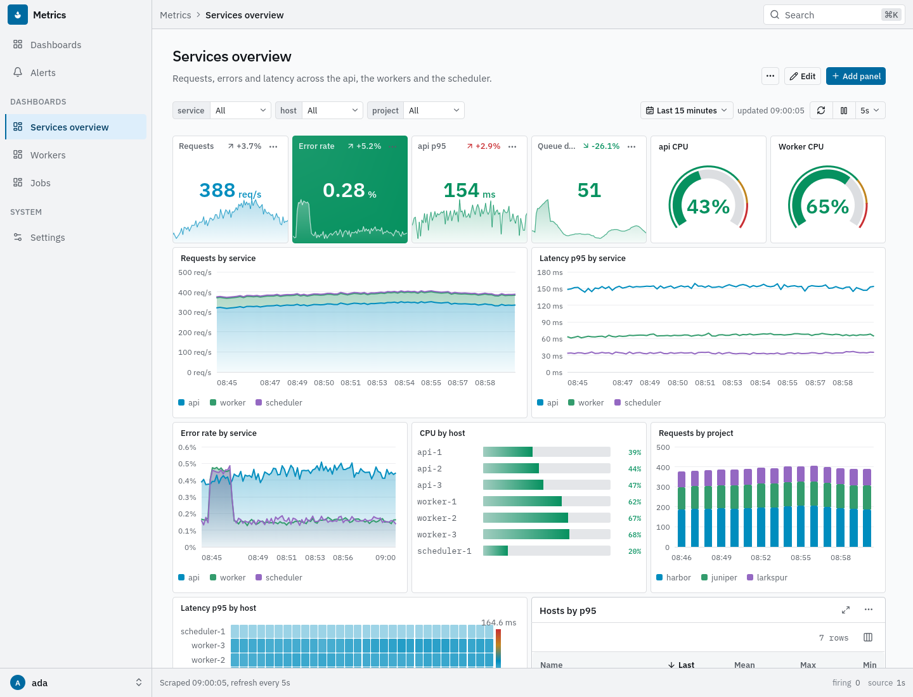
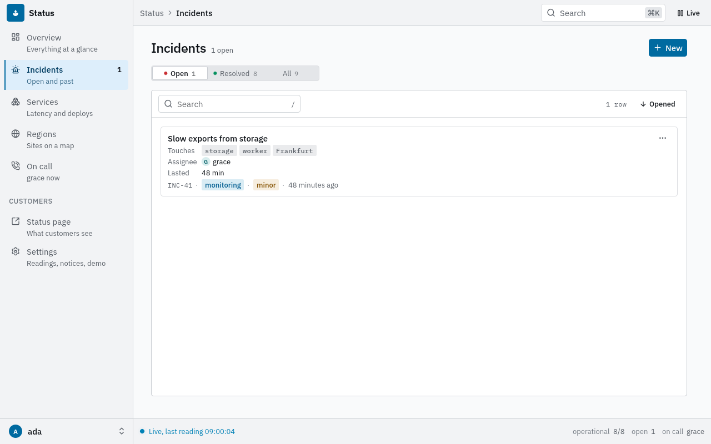
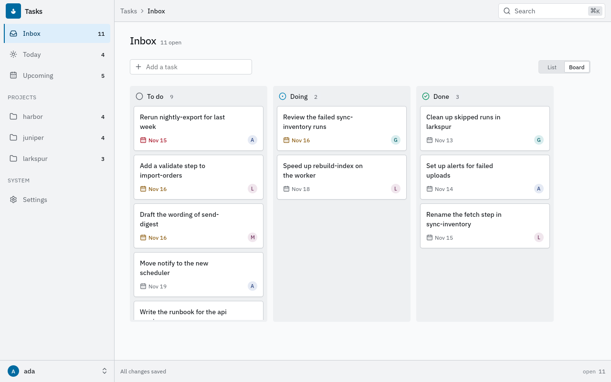
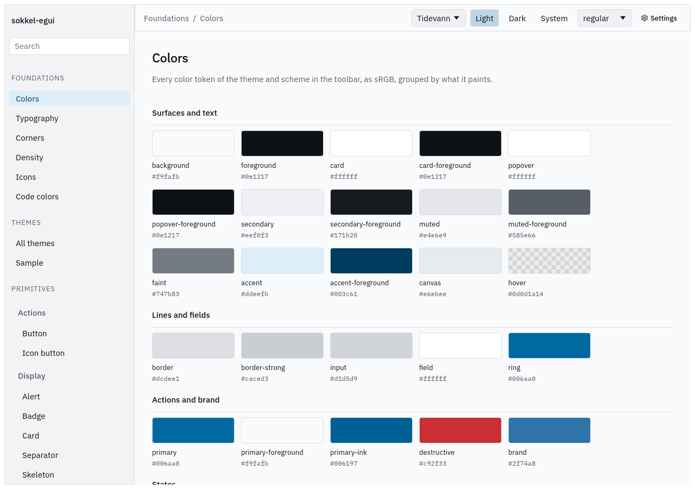

# sokkel-egui

[](https://github.com/winterop-com/sokkel-egui/actions/workflows/ci.yml)
[](https://github.com/winterop-com/sokkel-egui/actions/workflows/codeql.yml)
[](https://scorecard.dev/viewer/?uri=github.com/winterop-com/sokkel-egui)
[](https://winterop-com.github.io/sokkel-egui/)
[](Cargo.toml)
[](https://github.com/emilk/egui)
[](LICENSE)

[sokkel-ui](https://github.com/winterop-com/sokkel-ui)'s design system drawn with
[egui](https://github.com/emilk/egui): the same tokens and themes, its components as egui widgets,
and its example apps ported one to one. The tokens come from
[sokkel-design](https://winterop-com.github.io/sokkel-design/), the contract both renderers read,
so a theme, a scheme or a density reaches the web and the desktop alike.



## What is here

| Crate | What it holds |
|---|---|
| [`sokkel-egui`](crates/core) | Tokens, themes, text roles and the primitives: buttons, fields, tables, dialogs, the app frame, dashboards and more. |
| [`sokkel-egui-charts`](crates/charts) | Every chart drawn with egui's painter: lines, bars, gauges, heatmaps, funnels, donuts, waterfalls and their dashboard panels. |
| [`sokkel-egui-maps`](crates/maps) | Maps on walkers under the tokens: markers sized and colored by a scale, routes, legends and popups. |
| [`sokkel-egui-graph`](crates/graph) | Graphs of node boxes and edges laid out in ranks. |

The add-ons depend on the core by name, the core never on an add-on, and no add-on on another, as
in sokkel-ui.

## Examples

sokkel-ui's example apps, ported one to one, each checked against the web's own screens (see
[`docs/parity`](docs/parity)):

| Example | Run | Port |
|---|---|---|
| Tasks | `cargo run -p tasks` | [parity](docs/parity/tasks.md) |
| Status | `cargo run -p status` | [parity](docs/parity/status.md) |
| Dashboard | `cargo run -p dashboard` | [parity](docs/parity/dashboard.md) |
| Metrics | `cargo run -p metrics` | [parity](docs/parity/metrics.md) |
| Analytics | `cargo run -p analytics` | [parity](docs/parity/analytics.md), in progress |

Apps of egui's own, built only from the library's public parts: `runs`, `logs`, `planner` and
`storage` ([`docs/apps`](docs/apps)). The `storybook` shows every part in every theme
(`cargo run -p storybook`).

| | |
|---|---|
|  |  |
|  |  |

The API documentation and a gallery of every screen are at
[winterop-com.github.io/sokkel-egui](https://winterop-com.github.io/sokkel-egui/).

## Working on it

```sh
make all        # fmt-check, clippy with warnings denied, every test
make test       # every test; a changed screen leaves *.new.png and *.diff.png beside its snapshot
make snapshots  # accept the changed screens, once each has been looked at
make tokens     # copy sokkel-design's resolved tokens into the core crate
make help       # the rest
```

Every color, corner, size and text style a widget draws comes from the tokens: a widget never
carries a literal for something a token names. A difference from the web is fixed in the library,
never in an example alone. [`CLAUDE.md`](CLAUDE.md) holds the project's rules and
[`docs/plan.md`](docs/plan.md) what was learned along the way.

## License

All rights reserved; the source is published for reference only. See [`LICENSE`](LICENSE), and
[`THIRD_PARTY_NOTICES.md`](THIRD_PARTY_NOTICES.md) for the fonts and code it carries.
